# 🌿 Yeo Valley Bioacoustic Data Visualisation (`yeo-acoupi`)

**An interactive bioacoustic monitoring, telemetry, and audio/spectrogram visualisation platform developed by the Connected Environments Lab at UCL CASA in collaboration with Yeo Valley.**

This repository houses the **cloud ingestion configurations and interactive web visualisation suite** (`yeo-vis`) used to explore real-time biodiversity detections (birds & bats), edge node hardware health, and ultrasonic/acoustic field recordings captured across the Yeo Valley estate.

> [!NOTE]
> **Where is the Hardware & Edge Firmware Build Documentation?**
> All edge hardware setup, Arduino UNO Q / Raspberry Pi build guides, Acoupi edge configuration, LoRaWAN (`LA66`) and 4G cellular (`A7670E`) drivers, and field handover notes now live in the dedicated build repository: **[`djdunc/acoupi-yeo-valley`](https://github.com/djdunc/acoupi-yeo-valley)**. Legacy copies in the [`archive/`](archive/) directory of this repo are retained strictly for historical reference and **can be safely ignored by newcomers**.

---

## 🎯 Purpose of This Guide

This `README` introduces **makers, ecologists, and developers** to everything covered in this visualisation repository:
1. **Visualisation Showcase**: A complete tour of every web page, chart, map, and interactive audio/spectrogram tool created for the Yeo Valley deployment (with presentation-ready screenshots stored in [`assets/`](assets/)).
2. **Data Pipeline & Correlation Architecture**: How compact live telemetry in **InfluxDB v2** and high-resolution audio/spectrogram media in **Silo / MinIO S3** are dynamically correlated and rendered in the browser.
3. **Repository Tour & Operations**: How the codebase is structured, how to run the dashboard locally, and how updates are deployed via GitHub Actions and Portainer.

---

## 🏗️ Data & Visualisation Architecture

Capturing continuous 192 kHz 16-bit uncompressed ultrasonic audio in the field generates **~1.4 GB per hour (~33 GB/day per node)**. Because streaming raw audio over 4G cellular or LoRaWAN would rapidly drain solar batteries and SIM data budgets, the platform uses a **decoupled two-tier data architecture** that the visualisation app brings back together:

```
[ Solar Edge Nodes in Yeo Valley (Acoupi UNO Q: BirdNET & BatDetect2) ]
  │
  ├──► Tier 1: Live Detection Metadata & System Heartbeats (LoRaWAN / 4G Cellular / Wi-Fi)
  │      │  Compact JSON / binary payloads: Species ID (s), Confidence (c), CPU, RAM, SHM
  │      ▼
  │    [ MQTT Broker (mqtt.cetools.org) ] ──► [ Telegraf (sample-telegraf.conf) ] ──► [ InfluxDB v2 (CE_yeo) ]
  │
  └──► Tier 2: Full Audio (.wav) & Spectrograms (.png) (SD Spool / High-Bandwidth Sync)
         │  3-second acoustic & 192 kHz ultrasonic clips + pre-rendered spectrograms
         ▼
       [ Silo / MinIO S3 Bucket (buckets.cetools.org/yeo) ]
         │
         ▼
[ Streamlit Visualisation Application (yeo-vis.py + recording_explorer.py) ]
  └── Dynamically correlates S3 recordings with InfluxDB classifications via sliding time windows
```

---

## 🖼️ Visualisation Tour: Web Pages & Interactive Views

All screenshots below are stored at high resolution ($3200 \times 2000$ Retina) in the [`assets/`](assets/) directory for direct use in PowerPoint presentations and reports.

### 1. Deployed Devices Dashboard & Species Activity Timeline
**Entry point:** [`yeo-vis.py`](yeo-vis.py) (`Devices` $\rightarrow$ `Deployed Devices`)

The primary landing page tracks the 10 official solar-powered monitoring stations deployed across the Yeo Valley estate (`UNOQ-14-YV` through `UNOQ-31-YV`).
* **Sidebar Controls**: Filter by individual node or across all deployed devices, adjust the time window (`Last 24 Hours` to `Last 30 Days`), tune the model **Confidence Threshold** slider ($0.00 - 1.00$), filter by taxa (`Birds Only 🐦`, `Bats Only 🦇`, or `All Species`), and toggle false-positive filters (such as suspected BirdNET *Spotted Crake* ID 238 classifications).
* **Live Node Health**: Real-time `🟢 Online` / `🟡 Stale` / `🔴 Offline` status indicators with last-seen timestamps and a 24-hour heartbeat pulse sparkline.
* **KPI Summary Banner**: Instant readout of **High-Confidence Detections**, **Unique Species Identified**, **Top Species**, **Average Confidence**, and **Active Reporting Nodes**.
* **Species Activity Timeline**: A full-width interactive scatter plot of the top 15 active species where marker size scales with ML confidence, colour distinguishes birds vs. bats, and **astronomical sunset-to-sunrise bands** (computed dynamically for Yeo Valley's coordinates via `Astral`) shade nocturnal windows.

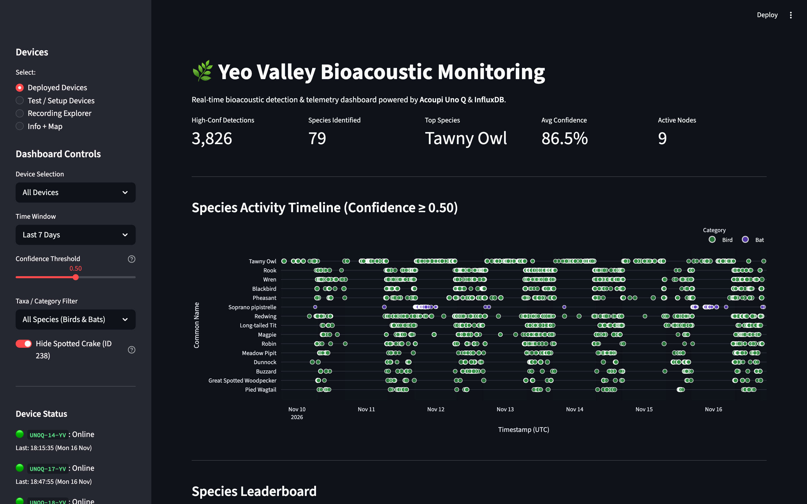

---

### 2. Species Leaderboard & Diurnal / Nocturnal Activity Profile
**Entry point:** [`yeo-vis.py`](yeo-vis.py) (Main panel below the Activity Timeline)

Scrolling down the main dashboard reveals two complementary ecological views:
* **Species Leaderboard**: An interactive ranking of every species detected within the selected window, complete with scientific taxonomy, category tags, embedded detection count progress bars, maximum confidence, and mean confidence scores.
* **Diurnal & Nocturnal Activity Profile (24-Hour Distribution)**: A stacked 24-hour bar chart (`00:00` to `23:00 UTC`) that illustrates the ecological handover between **diurnal bird chorus peaks** (dawn and late afternoon in green) and **nocturnal bat echolocation activity** (dusk through dawn in purple).

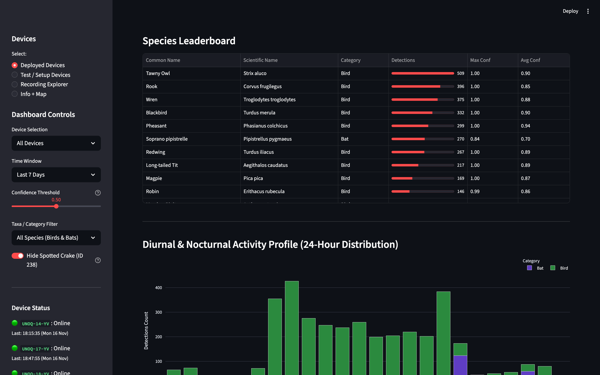

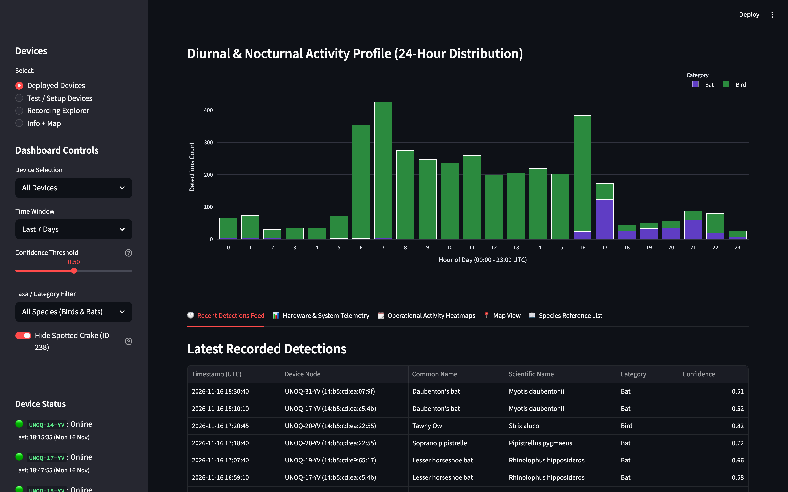

---

### 3. Diagnostic & Ecological Sub-Tabs
At the bottom of the dashboard, five dedicated tabs provide granular operational and ecological inspection:

#### 🕒 Tab 1: Recent Detections Feed
Displays a live chronological table of the 50 most recent high-confidence detections across the fleet, showing exact UTC timestamps, friendly device names and MAC addresses, common and scientific names, taxa category, and model confidence.

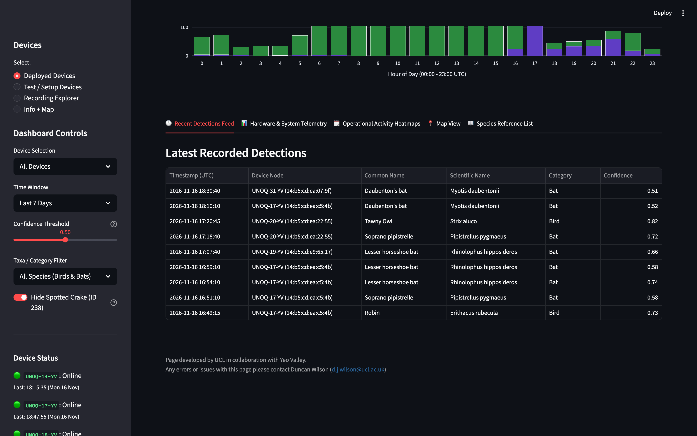

#### 📊 Tab 2: Hardware & System Telemetry
Tracks embedded Linux health metrics transmitted inside node heartbeat payloads (`acoupi_heartbeat`):
* **CPU Utilization (%)**: Monitors edge inference load from `BirdNET` and `BatDetect2`.
* **Free Memory (MB)**: Ensures long-running edge workers are not leaking RAM.
* **RAM Disk (`/run/shm`) Space (MB)**: Verifies that temporary in-memory audio buffers are properly cleaned up after inference so SD cards are protected from excessive wear.

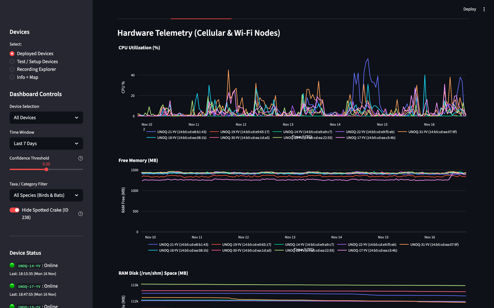

#### 🗓️ Tab 3: Device Operational Activity Heatmaps (24h Diurnal Grid)
Field IoT devices contend with solar battery depletion, canopy shading, and rural cellular/LoRaWAN attenuation. This tab renders a **24-Hour $\times$ Calendar Day Operational Matrix** for every node:
* `🟢 Green` cells indicate hours where the node successfully transmitted at least one heartbeat or detection payload.
* `🔴 Red` cells highlight silent/offline hours, immediately revealing solar duty-cycling patterns or connectivity dropouts alongside calculated **Operational Uptime (%)** metrics.

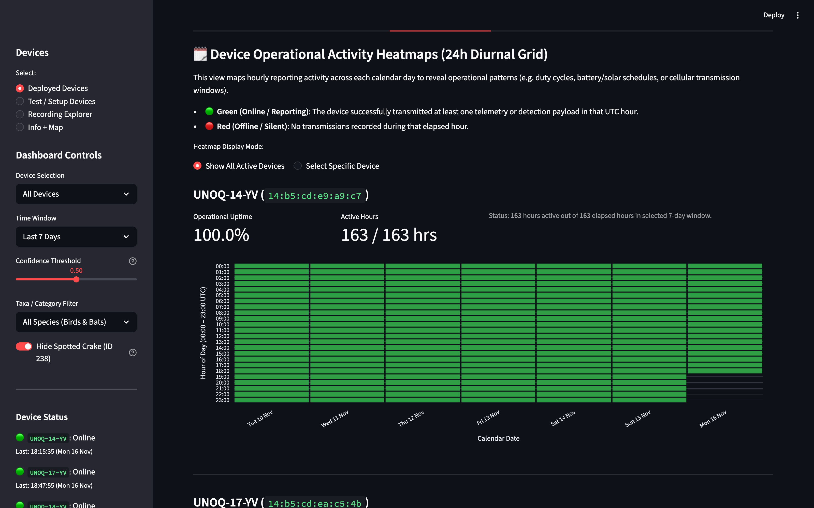

#### 📍 Tab 4: Active Node Map View
Embeds an interactive **Leaflet.js** map with switchable **Esri World Imagery (Satellite)** and **OpenStreetMap (Street)** layers, automatically fitting bounds to the active sensors in the current filter view.

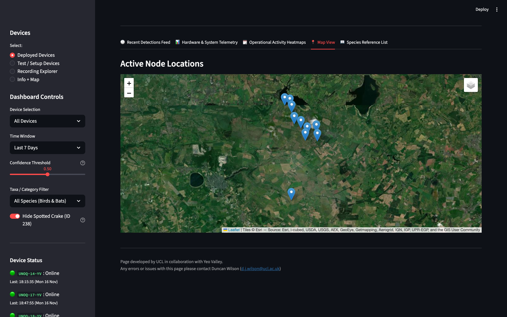

#### 📖 Tab 5: Species Reference Catalog
Provides a searchable, sortable browser for the platform's master taxonomy tables ([`data/yeo_valley_bird_species_list.csv`](data/yeo_valley_bird_species_list.csv) and [`data/yeo_valley_bat_species_list.csv`](data/yeo_valley_bat_species_list.csv)), mapping numeric edge IDs (`species_id`) to **208 British bird species** and **17 British bat species**.

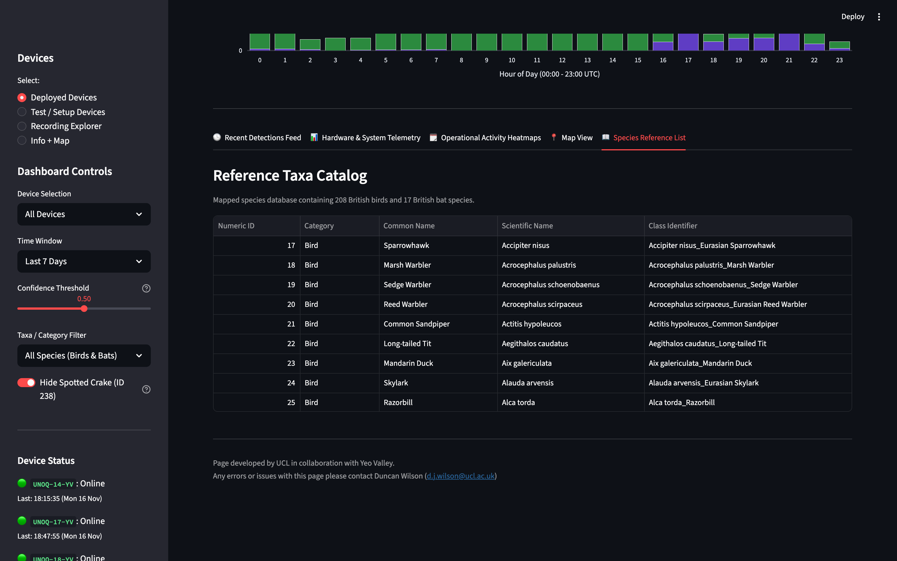

---

### 4. Test & Setup Devices View
**Entry point:** [`yeo-vis.py`](yeo-vis.py) (`Devices` $\rightarrow$ `Test / Setup Devices`)

Separates experimental lab benches, allotment soak-test rigs (`UNOQ-4-allotment-cellular`, `UNOQ-2-allotment-wifi`), and LoRaWAN test units from the official Yeo Valley estate statistics so makers can validate new firmware, solar configurations, and radio links without polluting production biodiversity metrics.

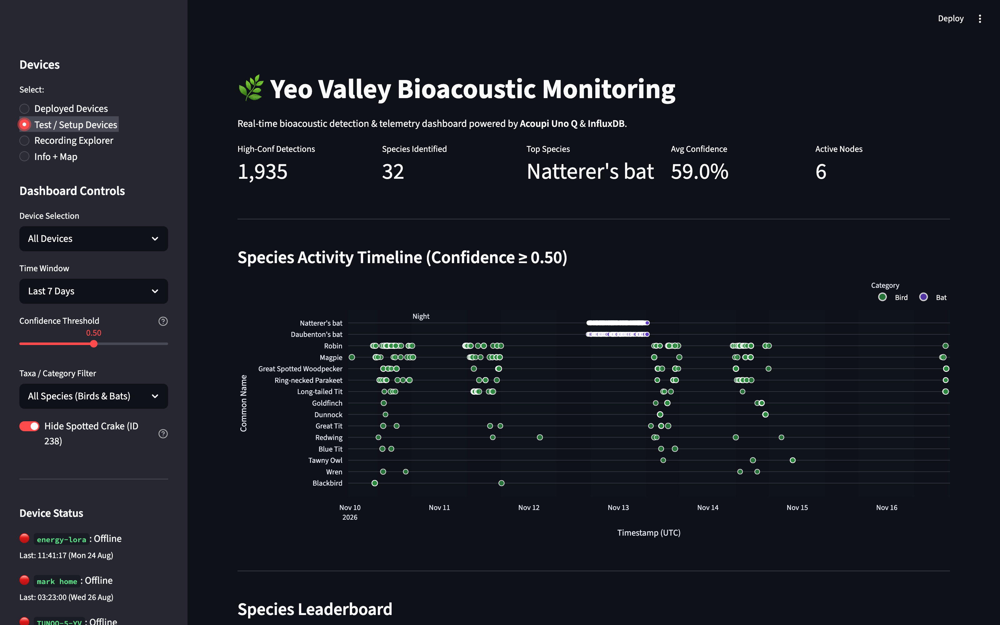

---

### 5. Bioacoustic Recording & Spectrogram Explorer
**Entry point:** [`recording_explorer.py`](recording_explorer.py), [`s3_service.py`](s3_service.py), [`metadata_correlator.py`](metadata_correlator.py) (`Devices` $\rightarrow$ `Recording Explorer`)

The **Recording Explorer** bridges the two storage tiers—browsing WAV recordings and spectrogram PNGs stored on the **Silo / MinIO S3 bucket** (`https://buckets.cetools.org/yeo`) and dynamically matching them to **InfluxDB** machine learning classifications using a sliding timestamp correlation window ($\pm 4\text{ seconds}$).

Key features built into this view:
* **Ecological Guild & Species Filtering**: Filter recordings by higher-level guilds (*Pipistrelles*, *Myotis Bats*, *Horseshoe Bats*, *Warblers*, *Finches*, *Thrushes*, *Raptors & Owls*, *Waterfowl & Rails*), specific species multiselects, confidence thresholds, and telemetry match status.
* **Custom Ultrasonic Web Audio API Bat Player**: Standard HTML5 `<audio>` players preserve pitch when slowing down playback, leaving ultrasonic bat calls ($20\text{ kHz} - 120\text{ kHz}$) completely inaudible to humans. The Recording Explorer embeds a custom **Web Audio API** player with pitch preservation disabled, defaulting to **`0.1x` (10× time expansion)** so a $45\text{ kHz}$ *Soprano pipistrelle* echolocation call drops to a crisp, audible $4.5\text{ kHz}$ chirp! Users can switch live between `0.1x (Audible)`, `0.25x`, `0.5x`, and `1.0x (Real-time)`.

#### Ultrasonic Bat Gallery (`BatDetect2`)
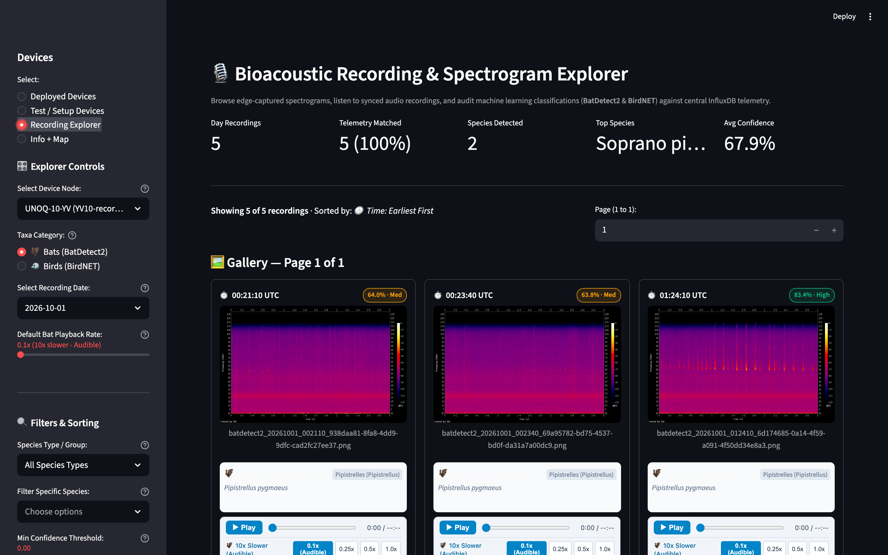

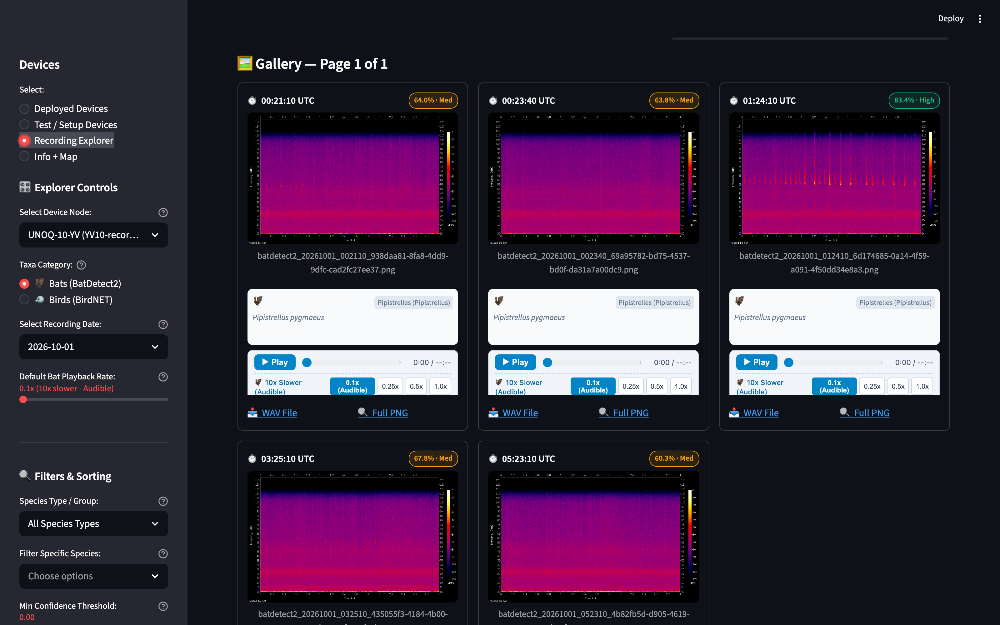

#### Acoustic Bird Gallery (`BirdNET`)
Switching the sidebar toggle to `🐦 Birds (BirdNET)` loads acoustic bird spectrograms and standard WAV audio players alongside their matched InfluxDB confidence badges and direct WAV/PNG download links.

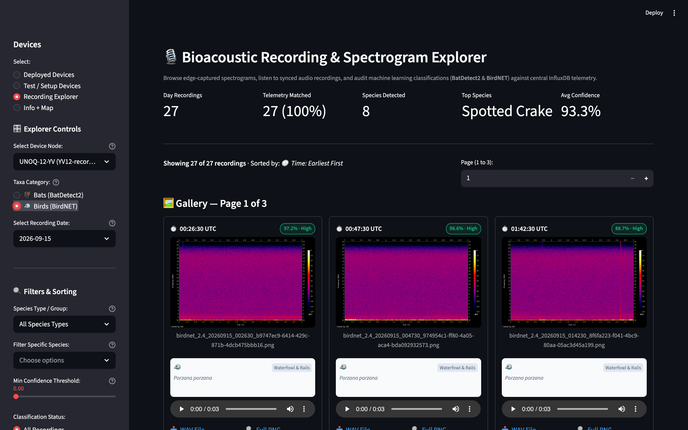

---

### 6. Project Info, Satellite Map & Field Deployment Gallery
**Entry point:** [`yeo-vis.py`](yeo-vis.py) (`Devices` $\rightarrow$ `Info + Map`)

Provides visitors and stakeholders with an overview of the Yeo Valley monitoring network, an interactive satellite map of all deployed sensor coordinates, and a 3-column photographic directory of the physical solar-powered **Acoupi UNO Q** installations in the field (`UNOQ-14-YV` to `UNOQ-31-YV`), complete with MAC addresses, firmware versions, and direct Google Maps links.

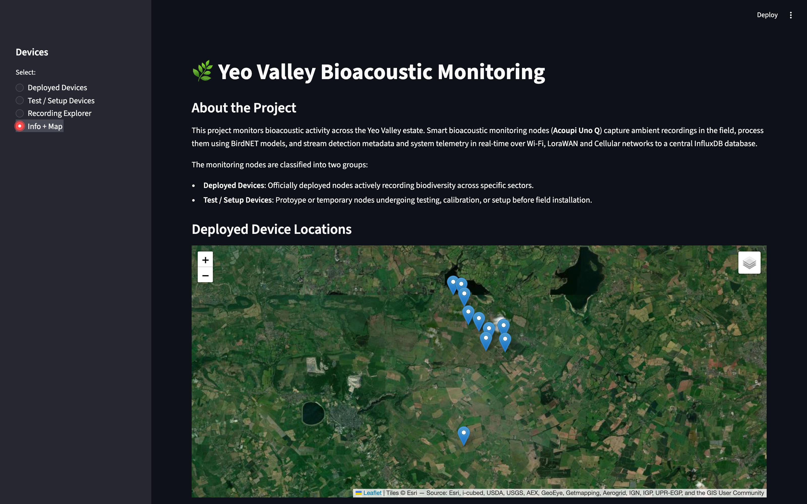

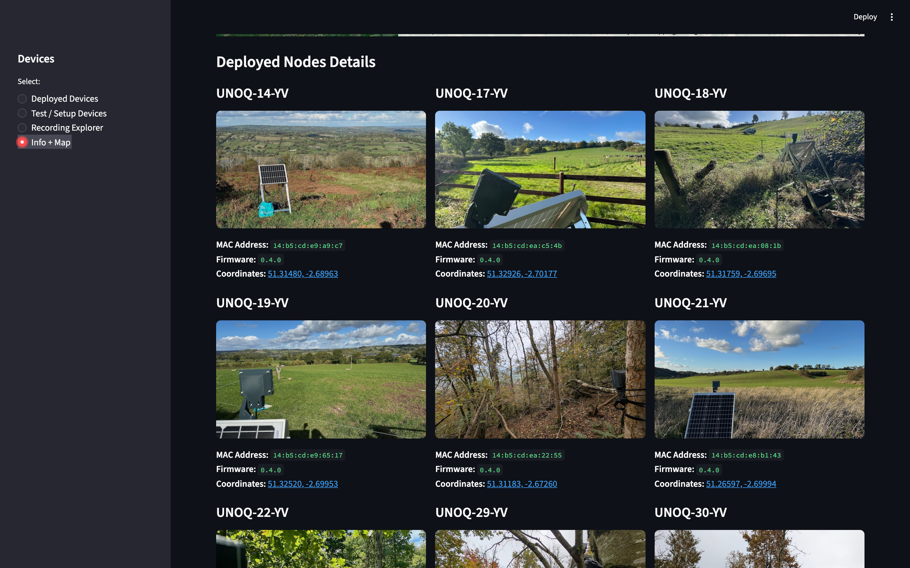

---

### 7. Exploratory Design Prototype: "Fieldsong" Interactive Biodiversity Map
**Captured in:** [`assets/15-biodiversity-map-prototype.png`](assets/15-biodiversity-map-prototype.png) – [`assets/17-biodiversity-map-light-theme.png`](assets/17-biodiversity-map-light-theme.png) *(archived HTML prototype in [`archive/handover/6-visualisation/biodiversity-map.html`](archive/handover/6-visualisation/biodiversity-map.html))*

During development, a standalone zero-dependency HTML/CSS/SVG/JS design prototype (**Fieldsong · Willowmere Farm Biodiversity**) was also created to explore next-generation visual storytelling concepts for farm-scale acoustic monitoring:
* **Multi-Lens Spatial Markers**: Colour and size habitat markers dynamically by **Species Richness**, **Native Ratio**, **Notable Species**, or **Sensor Health** across `24h`, `7 days`, `30 days`, or `Season` windows.
* **Farm Overview & Live Activity Stream**: Summarises total species heard, native share, richest/busiest habitats, weekly diversity trends, and a real-time streaming ticker.
* **Interactive Habitat Drill-Down Drawer**: Clicking any sensor marker on the map opens a detailed drawer showing habitat-specific species composition bars (distinguishing birds, bats, and non-native species), 7-day activity trends, and 24-hour diurnal rhythm curves in both Dark and Light cartographic themes.

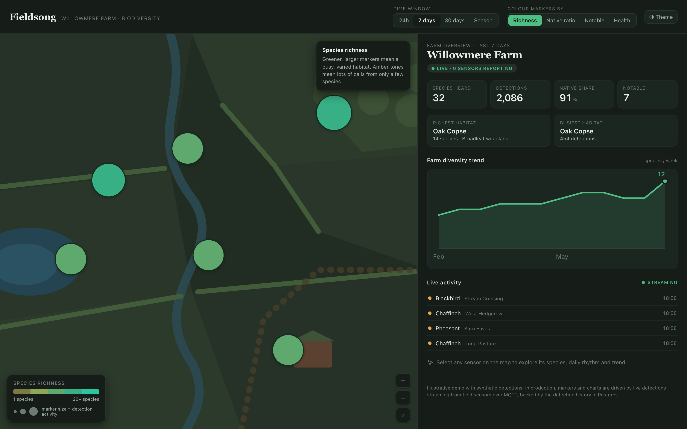

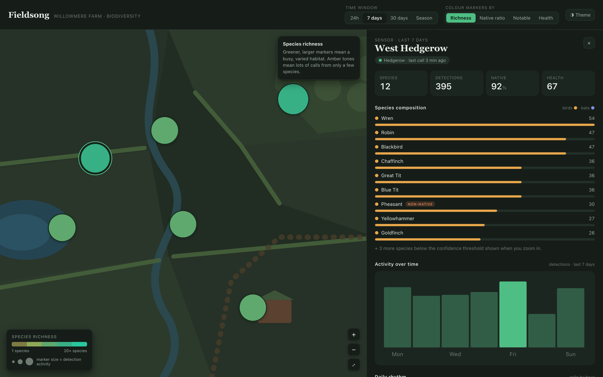

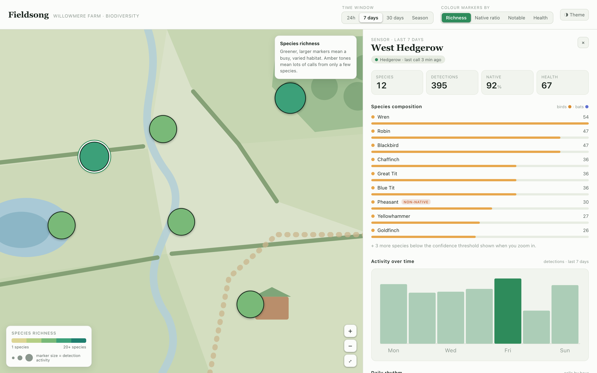

---

## 📂 Repository Structure

Newcomers only need to focus on the root Python application files, `data/`, and `assets/`. Everything inside `archive/` is legacy hardware/handover documentation that now lives in **[`djdunc/acoupi-yeo-valley`](https://github.com/djdunc/acoupi-yeo-valley)** and **can be ignored**.

```text
yeo-acoupi/
├── yeo-vis.py                  # Main Streamlit dashboard (Deployed, Test/Setup, Info + Map, 5 analytics tabs)
├── recording_explorer.py       # S3 Spectrogram & Audio Explorer + custom Web Audio API 0.1x ultrasonic player
├── s3_service.py               # MinIO / Silo S3 bucket discovery, zero-padded date walker & URL resolver
├── metadata_correlator.py      # Sliding-window timestamp correlator matching S3 media to InfluxDB detections
├── db-cleaner.py               # Maintenance utility for pruning retired/test device series from InfluxDB v2
├── sample-telegraf.conf        # Production Telegraf MQTT consumer (json_v2) -> InfluxDB v2 pipeline config
├── sample-program.conf         # Sample Acoupi edge configuration reference
├── Dockerfile & compose.yaml   # Containerisation and Nginx WebSocket reverse proxy configs
├── nginx.conf & Dockerfile.nginx
├── requirements.txt            # Python dependencies for the Streamlit visualisation app
├── how-to-update.md            # Step-by-step CI/CD & Portainer deployment runbook
├── architecture-notes.md       # Next-gen web architecture evaluation (Jamstack vs. Live MQTT WSS vs. FastAPI)
├── AGENTS.md                   # Platform engineering guide & multi-modal sensor expansion blueprint
├── assets/                     # 17 high-resolution screenshots of all web pages & visuals (for PowerPoint/docs)
├── data/
│   ├── yeo_valley_bird_species_list.csv   # 208 British bird species lookup table (ID, class, common & scientific name)
│   ├── yeo_valley_bat_species_list.csv    # 17 British bat species lookup table
│   ├── assets/img/                        # Field installation photos for UNOQ-14-YV through UNOQ-31-YV
│   └── UNOQ/20260531/                     # Sample 3-second 192 kHz bat WAV recordings & spectrogram PNGs
└── archive/                    # ⚠️ DEPRECATED / IGNORE: Moved to https://github.com/djdunc/acoupi-yeo-valley
```

---

## 🛠️ Key Visualisation Engineering Highlights

If you are maintaining or extending the visualisation app, keep these core design patterns in mind:

1. **Multi-Tier Device Identity & Alias Resolution ([`yeo-vis.py`](yeo-vis.py), [`s3_service.py`](s3_service.py))**:
   * Field hardware transitions across multiple identifiers over its lifecycle: hardware MAC addresses (`14:b5:cd:e9:a9:c7`), Linux hostnames (`yeo-unoq-14`), legacy tags (`UNOQ-10-YV`), formal deployment names (`UNOQ-29-YV`), and S3 folders (`YV10-recordings`).
   * `DEVICE_NAME_OVERRIDES`, `STATIC_ALIAS_TO_CANONICAL`, and `DEVICE_TO_S3_FOLDER` centralise these mappings and apply **natural sorting** (`natural_sort_key`) so `UNOQ-2` always precedes `UNOQ-10`.
2. **S3 Zero-Padding Resilience ([`s3_service.py`](s3_service.py))**:
   * Different edge upload scripts may format date directories with or without leading zeros (`2026/8/5/` vs. `2026/08/05/`). `list_recordings_for_day()` automatically queries both prefix variations before reporting a date as empty.
3. **Offline Sliding-Window Time Correlation ([`metadata_correlator.py`](metadata_correlator.py))**:
   * Because S3 filenames and InfluxDB telemetry do not share a foreign key, `correlate_recordings_with_detections()` extracts the UTC timestamp from each spectrogram filename (`YYYYMMDD_HHMMSS`) and matches it against InfluxDB detections within a configurable $\pm 4\text{ to }5\text{ second}$ window.
4. **Web Audio API Ultrasonic Time Expansion ([`recording_explorer.py`](recording_explorer.py))**:
   * `render_bat_audio_player()` decodes `.wav` buffers directly via `AudioContext.decodeAudioData()` and sets `source.playbackRate.value = 0.1` without pitch correction, shifting ultrasonic bat echolocation calls ($20\text{–}120\text{ kHz}$) down into the human audible spectrum ($2\text{–}12\text{ kHz}$).

---

## 🚀 Quick Start: Running the Dashboard Locally

### 1. Clone & Set Up Virtual Environment
```bash
git clone https://github.com/ucl-casa-ce/yeo-acoupi.git
cd yeo-acoupi
python3 -m venv venv
./venv/bin/pip install -r requirements.txt
```

### 2. Configure Secrets
Create `.streamlit/secrets.toml` (note: connecting to the internal UCL CETools InfluxDB instance requires an active **UCL VPN** connection):
```toml
INFLUX_URL = "http://128.40.193.25:8086"
INFLUX_TOKEN = "<your-influx-read-token>"
INFLUX_ORG = "UCL-CE"
INFLUX_BUCKET = "CE_yeo"

[s3]
ENDPOINT_URL = "https://buckets.cetools.org"
ACCESS_KEY = "<your-s3-access-key>"
SECRET_KEY = "<your-s3-secret-key>"
BUCKET_NAME = "yeo"
```

### 3. Launch the Dashboard
```bash
./venv/bin/streamlit run yeo-vis.py
```
Open **`http://localhost:8501`** in your browser.

### 4. Production Deployment
See [`how-to-update.md`](how-to-update.md) for the complete GitHub Actions (`ghcr.io/ucl-casa-ce/yeo-acoupi-vis:latest`) and **Portainer** deployment workflow.

---

## 📬 Credits & Contact

Developed by the **Connected Environments Lab** at the **Centre for Advanced Spatial Analysis (CASA), University College London (UCL)** in collaboration with **Yeo Valley**.

* **Contact**: Prof. Duncan Wilson (`d.j.wilson@ucl.ac.uk`)
